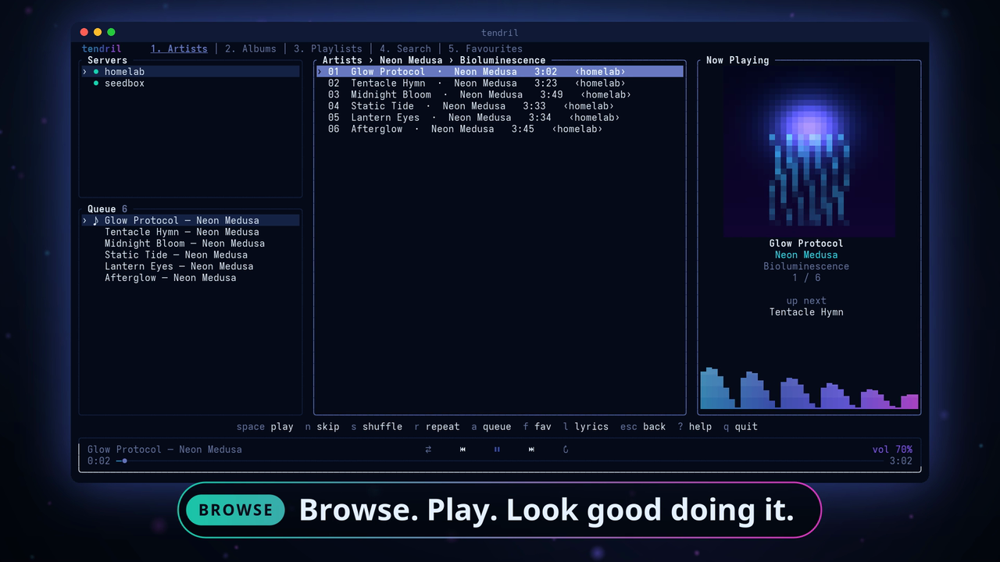
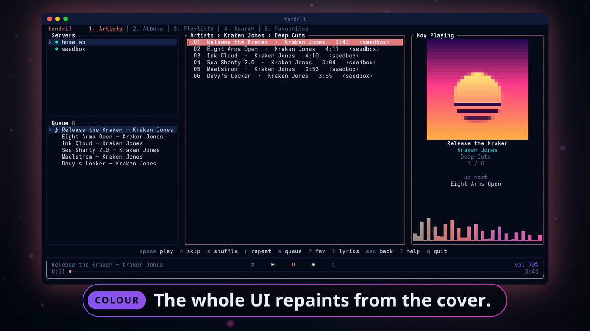
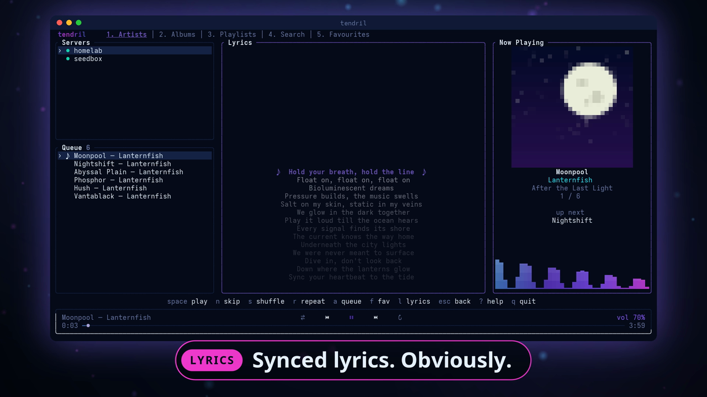
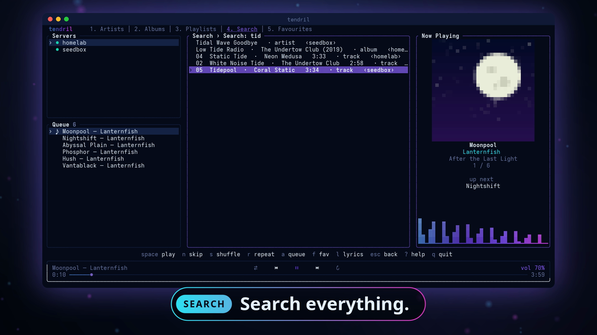
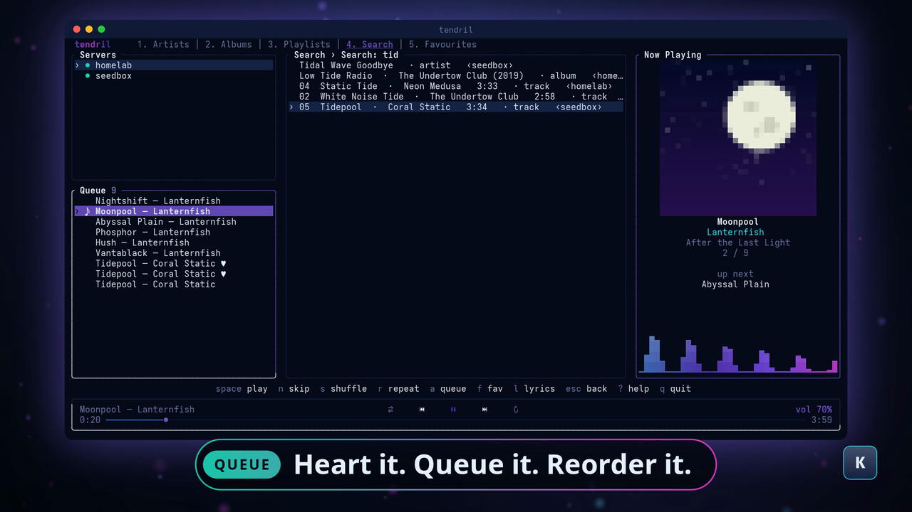
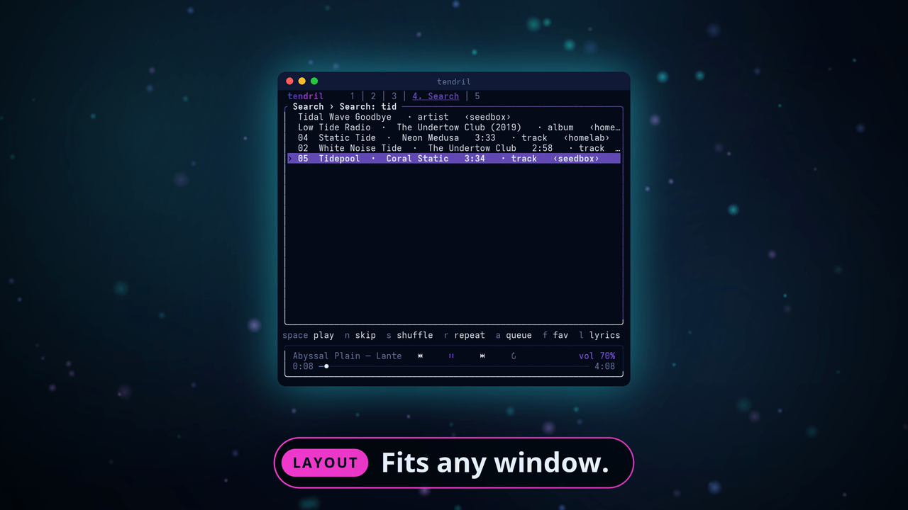

<p align="center">
  
</p>

<h1 align="center">tendril</h1>

<p align="center">
  <b>A Jellyfin music player for your terminal.</b><br>
  Many servers, one library. Looks like a pop star. Written in <a href="https://odin-lang.org">Odin</a>.
</p>

<p align="center">
  <a href="https://github.com/jgarza9788/tendril/actions/workflows/ci.yml"></a>
  <a href="https://github.com/jgarza9788/tendril/releases"></a>
  
  
</p>

<p align="center">
  
</p>

<p align="center">
  <a href="https://github.com/jgarza9788/tendril/releases/download/v0.1.0/Tendril-demo.mp4"><b>▶ Watch the 72-second demo (with sound)</b></a>
</p>

---

## Why you might like it

- **Every server, one library.** Log into as many Jellyfin servers as you like. Artists, albums, playlists, favourites and search results from all of them are merged into one list, each row tagged with where it lives.
- **The UI repaints itself from the cover.** Borders, selection, seek bar and visualizer all take the colours of whatever album is playing, and ease from one to the next. The cover itself is drawn in half-block pixels.
- **A real visualizer.** It records mpv's own audio stream and runs an FFT, so the bars are what you are actually hearing. (No PipeWire tools? It falls back to a gentle simulation.)
- **A proper player.** Gapless playback, ReplayGain, shuffle and repeat, seeking, volume, synced lyrics, favourites, and a queue you can edit, reorder, and save as a playlist. Your queue and position come back when you restart.
- **It plays well with your desktop.** Media keys, `playerctl` and status-bar widgets work through MPRIS. Plays and favourites are reported back to Jellyfin, so your play counts stay right.
- **It fits.** Three layouts that adapt to the window, and every key is rebindable.

<table>
  <tr>
    <td width="50%"><br><sub><b>Browse and play.</b> Two servers merged into one list.</sub></td>
    <td width="50%"><br><sub><b>Cover-driven colour.</b> The whole interface follows the album art.</sub></td>
  </tr>
  <tr>
    <td><br><sub><b>Synced lyrics</b> that scroll with the song (<code>l</code>).</sub></td>
    <td><br><sub><b>Search everything.</b> Artists, albums, playlists and tracks, grouped.</sub></td>
  </tr>
  <tr>
    <td><br><sub><b>Heart it, queue it, reorder it.</b></sub></td>
    <td><br><sub><b>Fits any window.</b> Down to a single pane.</sub></td>
  </tr>
</table>

## Install

You need **[mpv](https://mpv.io)** (it does the playback) and **curl** (it talks to Jellyfin). The AppImage and the tarball hold a statically linked binary, so they run on any x86-64 Linux with no minimum glibc. The Arch package is a normal build against your system.

| Format | How |
|---|---|
| **AppImage** | Download `Tendril-<version>-x86_64.AppImage` from the [releases](https://github.com/jgarza9788/tendril/releases), then `chmod +x` it and run it in a terminal. |
| **Arch Linux** | Download `tendril-<version>-1-x86_64.pkg.tar.zst`, then `sudo pacman -U` it. |
| **Tarball** | Download `tendril-<version>-x86_64-linux.tar.gz`, unpack it, then `./install.sh` (into `/usr/local`) or `PREFIX=~/.local ./install.sh`. |
| **From source** | `git clone --recurse-submodules https://github.com/jgarza9788/tendril`, then `cd tendril && ./build.sh run`. Needs [Odin](https://odin-lang.org) and clang. |

Check downloads against `SHA256SUMS` on the release page. An AUR package definition is in `packaging/aur/` (not published yet).

**Optional:** `pipewire-pulse` (`parec`, `pactl`) for the real audio spectrum, and `playerctl` to control Tendril from the shell.

## First run

```
tendril
```

A dialog asks for your server's URL, username and password. Only the access token is saved, in `~/.config/tendril/servers.json` with mode `0600`; your password is never stored. Press `N` any time to add another server, and `?` for the full key list.

No Jellyfin server handy? [Try the demo catalogue](#try-it-without-a-jellyfin-server).

## Keys

Press `?` in the app for the list. Every key below can be rebound ([Configuration](#configuration)).

| Key | Action |
|---|---|
| `space` | play / pause |
| `n` `p` | next / previous (`p` restarts the track if it is more than 3 s in) |
| `s` `r` | shuffle / repeat (off → all → one) |
| `+` `-` | volume |
| `,` `.` or `←` `→` | seek 10 s |
| `1`–`5`, `[` `]` | Artists / Albums / Playlists / Search / Favourites; previous / next tab |
| `/` | search artists, albums, playlists and tracks |
| `enter` / `esc` | open or play / go back (in the search box, `esc` returns to the list) |
| `a` `A` | add to the queue / play next |
| `f` `F` | favourite the selected item / the playing track |
| `l` | lyrics (synced when the server has them) |
| `d` `J` `K` | remove / move down / move up the selected queue row (queue pane focused) |
| `C` `W` | clear the queue / save it as a playlist |
| `g` + letter | jump to that letter in a long list |
| `R` | reload; retry a server that is down or expired |
| `T` | next theme |
| `v` | on a small terminal: cycle the middle pane (browser, queue, servers, now playing) |
| `tab` | change pane |
| `N` `X` | add / remove a server |
| `q` | quit |

The mouse works too: click tabs, rows, the transport buttons and the seek bar.

| Window width | Layout |
|---|---|
| 110+ columns | servers and queue on the left, browser in the middle, now playing on the right |
| 76–109 | browser and now playing (`v` shows the queue and servers in place of the browser) |
| under 76 | one pane at a time (`v` cycles) |

## Configuration

Optional, in `~/.config/tendril/config.json`. Anything you leave out keeps its default.

```json
{
  "volume": 70,
  "scrobble": true,
  "mpris": true,
  "theme": "abyss",
  "accent": "",
  "keys": {
    "next": ["n", "ctrl+n"],
    "help": ["f1"]
  }
}
```

- `theme`: `abyss`, `sunset`, `forest` or `mono`. Press `T` to cycle in the app.
- `accent`: `"#rrggbb"` pins the accent colour. Empty means follow the album cover.
- `scrobble`: report plays and favourites to the server (play counts, "recently played").
- `mpris`: expose Tendril to media keys and `playerctl`.
- `keys`: an action name mapped to its keys. Setting an action replaces its default keys. A key is a character (`n`, `N`, `+`) or one of `space`, `enter`, `esc`, `tab`, `backspace`, `up`, `down`, `left`, `right`, `f1`–`f12`, with an optional `ctrl+` or `alt+` prefix.

<details>
<summary>All action names</summary>

`quit`, `play_pause`, `next`, `prev`, `shuffle`, `repeat`, `vol_up`, `vol_down`, `seek_fwd`, `seek_back`, `tab_1` … `tab_5`, `tab_next`, `tab_prev`, `search`, `add_server`, `remove_server`, `queue_add`, `play_next`, `queue_remove`, `queue_up`, `queue_down`, `queue_clear`, `save_playlist`, `favorite`, `favorite_current`, `lyrics`, `retry`, `jump`, `help`, `back`, `theme_next`, `view_cycle`.

</details>

Files: servers and tokens in `servers.json` (same folder as the settings), and the last queue in `~/.local/state/tendril/session.json`.

## Media keys

With `mpris` on (the default), Tendril appears on the session bus as `org.mpris.MediaPlayer2.tendril`. Your desktop's media keys, `playerctl -p tendril …` and widgets such as waybar's `mpris` module can read what is playing and control it: play/pause, next, previous, seek, volume, shuffle and loop. (If another copy already holds that name, the second one registers as `tendril.instance<pid>`.)

## Try it without a Jellyfin server

`tools/mock_jellyfin.py` is a small fake server. With `DEMO` set it serves a catalogue of nine invented artists across two servers, with generated cover art and lyrics, which is what the demo film was recorded against:

```
DEMO=a python3 tools/mock_jellyfin.py 18096 homelab &
DEMO=b python3 tools/mock_jellyfin.py 18097 seedbox &
./build.sh run        # log in with 127.0.0.1:18096, any username, password: pw
```

Without `DEMO` you get a tiny library with an 8-second tone per track. Other switches: `BIG=1` (a 702-artist library), `ERR_ALBUM` / `BAD_ALBUM` (failing audio), `REVOKE_FILE` (token revocation) and `LOG_FILE` (a request log). The demo needs `numpy`.

## How it works

```
src/
  main.odin     frame loop, drawing, key handling
  app.odin      app state, navigation, playback, queue, scrobbling, lyrics, cover art
  keys.odin     rebindable actions
  worker.odin   network jobs on short-lived threads; results come back through a queue
  theme.odin    palettes and the hnoss theme
  config/       servers.json and config.json
  session/      the saved queue
  jellyfin/     REST client (curl) and API calls
  player/       mpv controller (JSON IPC over a Unix socket) and the play queue
  viz/          audio spectrum: records mpv's stream with parec and runs an FFT
  mpris/        a small D-Bus client that implements the MPRIS player interface
```

The UI thread never waits on the network. Each request parses into its own arena, which is freed when its view goes away. `./build.sh track` makes a build that prints a leak report on exit; the tested sessions report zero leaks.

Built on [hnoss](https://github.com/Huseynteymurzade28/hnoss), a pure-Odin TUI library (vendored as a git submodule), with [mpv](https://mpv.io) for audio and curl for HTTP.

## Development

```
./build.sh run        # build and launch
./build.sh test       # unit tests; no server or mpv needed
./build.sh check      # type-check only
./build.sh track      # a build that reports leaks on exit
```

Releases are built by `scripts/release/build.sh` and published by `scripts/release/publish.sh`; see [docs/RELEASING.md](docs/RELEASING.md). The demo film is made by the scripts in [demo/](demo/).

## Status

Tested against a Jellyfin 12.4 server and the mock server. Other Jellyfin versions are untested, and it has only been run on Arch Linux with Hyprland. Please open an issue if something misbehaves on your setup.

## License

MIT. See [LICENSE](LICENSE).
